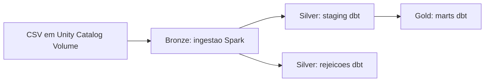

# Market Basket Analytics

Projeto de engenharia e analise de dados de cestas de compras no Databricks. A ingestao Spark carrega os arquivos CSV na camada Bronze; o dbt valida e transforma os dados em Silver e Gold.

## Arquitetura



| Camada | Local | Conteudo |
| --- | --- | --- |
| Bronze | `workspace.projeto_market_basket` | Carga integral dos CSVs em tabelas Delta. A ingestao usa `overwrite`. |
| Silver | `workspace.projeto_market_basket_silver` | Views `stg_*` com registros validos, sem chaves obrigatorias nulas e deduplicados. |
| Silver - rejeicoes | `workspace.projeto_market_basket_silver` | Tabelas `rej_*` com registros invalidos, motivo e timestamp da classificacao. |
| Gold | `workspace.projeto_market_basket_gold` | Dimensao de produtos e fatos de pedidos e itens. |

O sufixo `_silver`/`_gold` e aplicado pelo dbt a partir do schema base `projeto_market_basket` e das configuracoes `+schema` em `market_basket_dbt/dbt_project.yml`.

## Estrutura

```text
market_basket_etl/
|-- databricks.yml                    # Databricks Asset Bundle e Job
|-- extract/
|   |-- extract_data.py               # Ingestao Bronze e ponto de entrada do Job
|   `-- test_extract_data.py          # Testes unitarios pytest
|-- market_basket_dbt/
|   |-- dbt_project.yml
|   |-- macros/medallion_quality.sql  # Classificacao de nulos e duplicatas
|   |-- models/
|   |   |-- staging/                  # Silver: fontes, staging e rejeicoes
|   |   `-- marts/                    # Gold: dimensoes e fatos
|   `-- tests/                        # Testes singulares dbt
|-- requirements-dev.txt              # Dependencias de desenvolvimento
`-- logs/query_log.sql                # Consultas de analise
```

## Dados de entrada

Os arquivos devem estar no Unity Catalog Volume abaixo, com cabecalhos e nomes compativeis com os schemas definidos em `extract/extract_data.py`:

```text
/Volumes/workspace/projeto_market_basket/market_basket_raw/
|-- orders.csv
|-- products.csv
|-- aisles.csv
|-- departments.csv
|-- order_products__prior.csv
`-- order_products__train.csv
```

O Job executa `extract/extract_data.py`, que grava estas tabelas Delta:

- `workspace.projeto_market_basket.bronze_orders`
- `workspace.projeto_market_basket.bronze_products`
- `workspace.projeto_market_basket.bronze_aisles`
- `workspace.projeto_market_basket.bronze_departments`
- `workspace.projeto_market_basket.bronze_order_products_prior`
- `workspace.projeto_market_basket.bronze_order_products_train`

A Bronze preserva nulos e duplicatas para que possam ser auditados nas rejeicoes Silver. Cada execucao relê os CSVs e substitui as tabelas Bronze com `mode("overwrite")`; nao e uma carga incremental.

## Qualidade e rejeicoes

A macro `medallion_quality_model` classifica cada linha a partir dos campos obrigatorios e da chave natural configurada para cada fonte:

| Fonte | Campos obrigatorios | Chave de deduplicacao |
| --- | --- | --- |
| `bronze_orders` | `order_id`, `user_id` | `order_id` |
| `bronze_products` | `product_id`, `product_name` | `product_id` |
| `bronze_aisles` | `aisle_id`, `aisle` | `aisle_id` |
| `bronze_departments` | `department_id`, `department` | `department_id` |
| `bronze_order_products_prior` | `order_id`, `product_id`, `add_to_cart_order`, `reordered` | `order_id`, `product_id` |
| `bronze_order_products_train` | `order_id`, `product_id`, `add_to_cart_order`, `reordered` | `order_id`, `product_id` |

Os registros validos ficam nos modelos `stg_*`. Duplicatas sao identificadas com `row_number()` por chave, priorizando o maior `processed_data`; apenas a primeira linha e mantida. As demais linhas e aquelas com campos obrigatorios nulos sao direcionadas aos modelos `rej_*`.

Cada rejeicao tem:

- `Rejection_Reason`: `NULL_REQUIRED_FIELD` ou `DUPLICATE_PRIMARY_KEY`.
- `Rejected_At`: timestamp da classificacao pelo dbt.

Os aliases expostos pelos modelos dbt usam `Pascal_Case` (por exemplo, `Order_ID` e `Product_Name`). Os nomes fisicos das fontes Bronze permanecem snake_case.

## Modelos dbt

### Silver

- `stg_orders`: pedidos validos e deduplicados.
- `stg_products`: produtos validos e deduplicados.
- `stg_aisles`: corredores validos e deduplicados.
- `stg_departments`: departamentos validos e deduplicados.
- `stg_order_products_prior`: itens validos da particao `prior`.
- `stg_order_products_train`: itens validos da particao `train`.
- `rej_orders`, `rej_products`, `rej_aisles`, `rej_departments`, `rej_order_products_prior` e `rej_order_products_train`: registros rejeitados por cada regra de qualidade.

### Gold

- `dim_products`: produtos enriquecidos com corredor e departamento.
- `fct_order_products`: um produto por pedido, unindo as particoes `prior` e `train` e adicionando dados do pedido e do produto.
- `fct_orders`: um registro por pedido, com `Product_Count` calculado a partir dos itens Silver validos.

A documentacao de fontes, modelos e colunas, bem como testes genericos de qualidade, esta nos arquivos YAML dentro de `market_basket_dbt/models/`. Os testes dbt cobrem valores nulos, unicidade, relacionamentos, valores aceitos e duplicidade na fato de itens.

## Job Databricks

`databricks.yml` define o Asset Bundle `market-basket-dbt` e o Job `market_basket_dbt`. O Job executa as tarefas nesta ordem:

1. `extract_bronze`: executa o script PySpark de ingestao.
2. `build_market_basket`: depende do sucesso de `extract_bronze` e executa `dbt deps` e `dbt build`.

A tarefa Bronze grava no catalogo/schema `workspace.projeto_market_basket`. A tarefa dbt usa o SQL Warehouse definido pela variavel `warehouse_id`, catalogo `workspace` e schema base `projeto_market_basket`. O ambiente serverless e definido no Bundle e inclui `dbt-databricks`.

O target configurado e `dev`. A execucao deve ser feita por uma identidade Databricks com permissao para:

- Ler os arquivos no Volume `market_basket_raw`.
- Usar o catalogo `workspace` e os schemas de origem e destino.
- Criar e alterar tabelas/views Bronze, Silver e Gold.
- Usar o SQL Warehouse configurado no Job.

## Executar no Databricks

Requisitos: Databricks CLI autenticado no workspace, Asset Bundles habilitado, SQL Warehouse acessivel e Volume com os seis CSVs.

Na raiz do repositorio:

```bash
databricks bundle validate --target dev
databricks bundle deploy --target dev
databricks bundle run market_basket_dbt --target dev
```

Se a sessao local definir `DATABRICKS_CLUSTER_ID` e o CLI aplicar um override de cluster durante a validacao ou implantacao, remova-o para estes comandos:

```bash
env -u DATABRICKS_CLUSTER_ID databricks bundle validate --target dev
env -u DATABRICKS_CLUSTER_ID databricks bundle deploy --target dev
env -u DATABRICKS_CLUSTER_ID databricks bundle run market_basket_dbt --target dev
```

O Job tambem pode ser iniciado na interface em **Workflows > Jobs**, selecionando `market-basket-dbt-dev`. Os logs da ingestao aparecem na saida da tarefa `extract_bronze`.

## Executar localmente

A ingestao Spark foi projetada para rodar no Databricks, onde estao disponiveis Spark, Unity Catalog e o Volume. O dbt pode ser executado localmente depois da autenticacao e configuracao do profile `market_basket_dbt` em `~/.dbt/profiles.yml`, apontando para o mesmo workspace, SQL Warehouse, catalogo e schema.

```bash
cd market_basket_dbt
dbt debug --profile market_basket_dbt
dbt build --profile market_basket_dbt
```

`dbt build` requer que as tabelas Bronze ja existam. Para rodar a ingestao manualmente no Databricks, execute `extract/extract_data.py`; o ponto de entrada chama as seis funcoes de ingestao em sequencia.

## Testes locais

Os testes pytest simulam as interfaces PySpark usadas pelo extrator e nao precisam de um cluster Databricks:

```bash
python -m pip install -r requirements-dev.txt
python -m pytest -q extract/test_extract_data.py
```

A suite verifica a normalizacao repetivel de colunas, a escrita idempotente em Delta `overwrite` e a ordem de execucao das seis ingestões. Os testes dbt sao executados junto com `dbt build` no Job.

## Saidas e logs

- Logs Python: stdout/stderr da tarefa `extract_bronze` no historico do Job.
- Logs dbt: saida da tarefa `build_market_basket` e artifacts dbt no diretorio de target do projeto durante a execucao.
- Rejeicoes: tabelas `rej_*` no schema Silver, com os dados originais e os campos de auditoria.

## Diagnostico

**`TABLE_OR_VIEW_NOT_FOUND` nas fontes dbt**

Verifique se `extract_bronze` concluiu com sucesso antes de `build_market_basket`. Confirme se os seis arquivos estao no Volume esperado, se o Job foi executado com a identidade correta e se as tabelas foram gravadas em `workspace.projeto_market_basket`.

**Falha de acesso ao Volume ou catalogo**

Revise as permissoes Unity Catalog da identidade configurada em `Run as`, principalmente leitura do Volume, `USE CATALOG`, `USE SCHEMA` e permissoes de criacao/alteracao nas tabelas de destino.

**Falha de autenticacao em execucao local**

Confirme que `~/.dbt/profiles.yml` possui o profile `market_basket_dbt` e que o Databricks CLI esta autenticado no workspace correto. O Job Databricks usa a identidade definida em `Run as` e nao reutiliza tokens locais.

**Rejeicoes inesperadas**

Consulte `Rejection_Reason` nas tabelas `rej_*`. `NULL_REQUIRED_FIELD` indica campo obrigatorio nulo; `DUPLICATE_PRIMARY_KEY` indica mais de uma linha para a chave natural definida na tabela de qualidade.
